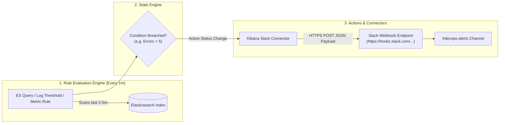

# 🔔 Production Guide: Kibana Dashboards & Slack Alerting Integration

> **Scope**: Building production-grade Kibana Lens dashboards, automating dashboards via GitOps/API, integrating Slack alerts with Incoming Webhooks, designing actionable alert payloads, and preventing alert fatigue.

---

## 📑 Table of Contents
1. [Architecture: Alerting & Actions Framework](#1-architecture-alerting--actions-framework)
2. [Building Production E-Commerce Dashboards with Kibana Lens](#2-building-production-e-commerce-dashboards-with-kibana-lens)
   - [2.1. The E-Commerce Simulator Workload](#21-the-e-commerce-simulator-workload)
   - [2.2. The 4 Essential DevOps Panels](#22-the-4-essential-devops-panels)
   - [2.3. Step-by-Step UI Creation Guide](#23-step-by-step-ui-creation-guide)
   - [2.4. Automating Dashboards via GitOps (Saved Objects API)](#24-automating-dashboards-via-gitops-saved-objects-api)
3. [Integrating Alerts with Slack (Step-by-Step)](#3-integrating-alerts-with-slack-step-by-step)
   - [Step 1: Create Slack Incoming Webhook](#31-step-1-create-slack-incoming-webhook)
   - [Step 2: Create Slack Connector in Kibana (UI & API)](#32-step-2-create-slack-connector-in-kibana-ui--api)
   - [Step 3: Create Alerting Rule & Wire to Slack (UI & API)](#33-step-3-create-alerting-rule--wire-to-slack-ui--api)
   - [Step 4: Design Actionable Slack Messages (Mustache Formatting)](#34-step-4-design-actionable-slack-messages-mustache-formatting)
4. [SRE Alerting Hygiene & Best Practices](#4-sre-alerting-hygiene--best-practices)
   - [Preventing Alert Storms & Fatigue](#41-preventing-alert-storms--fatigue)
   - [Snoozing, Muting & Acknowledging Alerts](#42-snoozing-muting--acknowledging-alerts)
5. [Hands-On Lab: Test Your Slack Alert End-to-End](#5-hands-on-lab-test-your-slack-alert-end-to-end)

---

## 1. Architecture: Alerting & Actions Framework

Kibana provides an event-driven Alerting & Actions engine decoupled from Elasticsearch queries:



### Core Concepts:
- **Alerting Rule**: Defines *when* to alert (e.g. check `elk-logstash-*` every 1 minute for documents where `log.level == "ERROR" > 5`).
- **Connector**: Reusable credentialed integration channel (Slack, Webhook, PagerDuty, Email, Jira).
- **Action**: The link between a Rule and a Connector, containing message templates populated by Mustache dynamic variables.
- **Action Group**: Lifecycle states (`Recovered`, `Fired`, `Warning`). Actions can trigger only when the state changes to prevent alert storms.

---

## 2. Building Production E-Commerce Dashboards with Kibana Lens

A production-grade microservice dashboard gives an on-call engineer immediate answers to three critical questions within 5 seconds:
1. *Is there an active incident right now?* (Top-level error rate gauge / health status)
2. *Which microservice is failing?* (Breakdown of errors by `service.name`)
3. *What is the exact error and customer impact?* (Embedded live log stream with `error.code`, `order_id`, and `message`)

---

### 2.1. The E-Commerce Simulator Workload

We simulate a real-world e-commerce microservices backend using [`ecommerce-simulator.yaml`](ecommerce-simulator.yaml). It continuously generates structured JSON logs across 4 microservices:

| Microservice (`service.name`) | Log Levels Emitted | Simulated Events & Failure Scenarios |
| :--- | :--- | :--- |
| **`frontend`** | `INFO`, `WARN` | Page rendering, checkout page loads, slow asset bundle latency (1150ms). |
| **`auth-service`** | `INFO`, `WARN`, `ERROR` | JWT session validation, expired refresh tokens, invalid Bearer signatures (`error_code: 401`). |
| **`order-service`** | `INFO`, `WARN`, `ERROR` | Order queued, inventory lock retry, database write conflict deadlock (`error_code: 500`). |
| **`payment-service`** | `INFO`, `WARN`, `ERROR` | Stripe payments captured, gateway high latency (2800ms), gateway connection timeouts (`error_code: 504`). |

#### Log Pipeline Processing:
Each container log is emitted as JSON and shipped via Filebeat to Logstash. Logstash parses the JSON keys directly into ECS-compliant fields in Elasticsearch:
- `service.name`: `frontend`, `auth-service`, `order-service`, `payment-service`
- `log.level`: `INFO`, `WARN`, `ERROR`
- `error.code`: `401`, `500`, `504`
- `order_id`: Order transaction ID (e.g. `5001`, `5002`)
- `message`: Human-readable log details
- `@timestamp`: Event timestamp

#### Deploying & Verifying the Workload:
```bash
# Apply the workload
kubectl apply -f ecommerce-simulator.yaml

# Verify pod status
kubectl get pods -l app=ecommerce-simulator

# Tail live multi-service logs
kubectl logs -l app=ecommerce-simulator --tail=10
```

---

### 2.2. The 4 Essential DevOps Panels

```text
+-----------------------------------------------------------------------------------+
|  [Panel 1: Error Rate Gauge]        |  [Panel 2: Top Failing Services (Donut)]     |
|  ERROR %: 5.2% (Target < 5%)        |  - payment-service: 48%                      |
|  Status: WARNING                     |  - order-service: 32%                        |
|                                     |  - auth-service: 20%                         |
+-----------------------------------------------------------------------------------+
|  [Panel 3: Log Volume Over Time by Severity (Stacked Bar Chart)]                   |
|  [Bars partitioned by INFO (Green), WARN (Yellow), ERROR (Red) over time]          |
+-----------------------------------------------------------------------------------+
|  [Panel 4: Live Filtered Error Log Stream (Discover Table Embed)]                  |
|  Time | Service | Level | Error Code | Order ID | Message                         |
+-----------------------------------------------------------------------------------+
```

---

### 2.3. Step-by-Step UI Creation Guide

#### 0. Environment Setup & Access
1. Open Kibana in your browser: **[http://localhost:5601](http://localhost:5601)**
   - **Username**: `elastic`
   - **Password**: `0P1rf1AiLY0ucHSd`
2. Set the global time range in the top-right corner to **Last 15 minutes**.
3. Set the refresh interval to **5 seconds** (auto-refresh).

#### 1. Open Dashboard Hub
1. In Kibana, open the main menu (☰) $\to$ **Analytics** $\to$ **Dashboard**.
2. Click **Create new dashboard**.

#### 2. Create Panel 1: Log Volume Over Time by Severity (Stacked Bar Chart)
1. Click **Create visualization** (opens **Kibana Lens**).
2. Ensure the top-left Data View is set to **`Kubernetes Logs (ELK)` (`elk-*`)**.
3. **Configuration**:
   - Drag **`@timestamp`** onto the **Horizontal axis** (X-axis).
   - Drag **`Count of records`** onto the **Vertical axis** (Y-axis).
   - Drag **`log.level`** into the **Break down by** field.
   - Set Chart type (top dropdown) to **Stacked Bar**.
4. **Customize Colors**:
   - In the legend or right-hand panel, click the color swatch for each level:
     - `ERROR` $\to$ **Red** (`#E74C3C`)
     - `WARN` $\to$ **Yellow / Orange** (`#F39C12`)
     - `INFO` $\to$ **Green** (`#2ECC71`)
5. In the top bar, click **Save and return**.
   - **Title**: `Log Ingestion Volume by Severity`.


#### 3. Create Panel 2: Top Failing Microservices (Donut Chart)
1. Click **Create visualization** in your dashboard.
2. In the top KQL search bar, add a filter for errors only:
   ```kql
   log.level : "ERROR"
   ```
   Press **Enter**.
3. Set the Chart Type dropdown (top-center) to **Donut** (or **Pie**).
4. In the field list on the left:
   - Drag **`service.name`** into **Slice by**.
   - Confirm the metric is **`Count of records`**.
5. Notice the donut chart automatically groups errors by `payment-service`, `order-service`, and `auth-service`.
6. Click **Save and return**.
   - **Title**: `Top Erroring Microservices`.


#### 4. Create Panel 3: Application Error Rate Percentage (Metric Gauge)
1. Click **Create visualization**.
2. Change the Chart Type to **Metric**.
3. In the right configuration panel, click on **Primary metric** to open the calculation editor.
4. Switch to the **Formula** tab and enter:
   ```text
   count(kql='log.level : "ERROR"') / count()
   ```
5. Under **Value formatting**, select **Percent** (e.g. `0.0%`).
6. Under **Coloring & Palettes**:
   - Set threshold ranges:
     - `< 5%`: **Green** (Normal SLA)
     - `5% - 15%`: **Yellow** (Elevated latency/transient retries)
     - `> 15%`: **Red** (Critical Outage)
7. Click **Save and return**.
   - **Title**: `Application Error Rate`.


#### 5. Create Panel 4: Live Filtered Error Log Stream (Discover Embed)
1. From the main menu (☰), navigate to **Analytics** $\to$ **Discover**.
2. Select the Data View **`Kubernetes Logs (ELK)` (`elk-*`)**.
3. Enter the KQL query in the search bar:
   ```kql
   log.level : "ERROR"
   ```
4. In the field list on the left, click the **+ (plus)** icon next to each field to add it as a column:
   - `@timestamp`
   - `service.name`
   - `log.level`
   - `error.code`
   - `order_id`
   - `message`


5. Click **Save** in Discover's top toolbar $\to$ Name it `E-Commerce Live Error Feed`.


7. Return to your Dashboard $\to$ Click **Add from library** $\to$ Select `E-Commerce Live Error Feed`.


#### 6. Organize and Save the Dashboard
1. Arrange the grid layout:
   - **Top row**: Place `Application Error Rate` (Metric Gauge) on the left (width: 16) and `Top Erroring Microservices` (Donut) on the right (width: 32).
   - **Middle row**: Place `Log Ingestion Volume by Severity` spanning full width (width: 48).
   - **Bottom row**: Place `E-Commerce Live Error Feed` spanning full width (width: 48).
2. Click **Save** in the top navigation bar.
3. Set the Title to: **`[DevOps] E-Commerce Observability Dashboard`**.
4. Check **Store time with dashboard** so opening the dashboard defaults to the `Last 15 minutes` window.


---

### 2.4. Automating Dashboards via GitOps (Saved Objects API)

In modern CI/CD, dashboards are stored in git as JSON/NDJSON and automatically pushed to Kibana on deployment.

#### Exporting Dashboard to File:
```bash
ES_PWD=$(kubectl get secret -n logging elasticsearch-master-credentials -o jsonpath="{.data.password}" | base64 --decode)

curl -sk -u "elastic:$ES_PWD" -H "kbn-xsrf: true" \
  -X POST "http://localhost:5601/api/saved_objects/_export" \
  -H "Content-Type: application/json" \
  -d '{
    "type": ["dashboard"],
    "includeReferencesDeep": true
  }' > k8s-dashboard-export.ndjson
```

#### Importing Dashboard via CI/CD Pipeline:
```bash
curl -sk -u "elastic:$ES_PWD" -H "kbn-xsrf: true" \
  -X POST "http://localhost:5601/api/saved_objects/_import?overwrite=true" \
  -H "Content-Type: multipart/form-data" \
  -F file=@k8s-dashboard-export.ndjson
```

---

## 3. Integrating Alerts with Slack (Step-by-Step)

---

### 3.1. Step 1: Create Slack Incoming Webhook
1. Go to [Slack API: Your Apps](https://api.slack.com/apps).
2. Click **Create New App** $\to$ Select **From scratch**.
3. Name your app (e.g. `Kubernetes-Alertmanager-Kibana`) and pick your Slack Workspace.
4. Under **Add features and functionality**, click **Incoming Webhooks**.
5. Toggle **Activate Incoming Webhooks** to **On**.
6. Click **Add New Webhook to Workspace** at the bottom.
7. Select the target channel (e.g. `#devops-alerts` or `#incidents`) and click **Allow**.
8. **Copy the Webhook URL**:
   `https://hooks.slack.com/services/YOUR/WORKSPACE/WEBHOOK_URL`

---

### 3.2. Step 2: Create Slack Connector in Kibana (UI & API)

#### Option A: Via Kibana UI
1. In Kibana, open Menu (☰) $\to$ **Management** $\to$ **Stack Management**.
2. Under **Alerts and Insights**, click **Connectors**.
3. Click **Create connector** $\to$ Choose **Slack**.
4. Fill in:
   - **Name**: `Slack - #devops-alerts`
   - **Webhook URL**: Paste your copied Slack webhook URL.
5. Click **Save**.

#### Option B: Programmatically via Kibana REST API (DevOps Automation)
Run this command from your terminal:

```bash
ES_PWD=$(kubectl get secret -n logging elasticsearch-master-credentials -o jsonpath="{.data.password}" | base64 --decode)
KIBANA_POD=$(kubectl get pod -n logging -l app=kibana -o jsonpath='{.items[0].metadata.name}')

SLACK_WEBHOOK_URL="https://hooks.slack.com/services/YOUR/WORKSPACE/WEBHOOK_URL"

kubectl exec -n logging "$KIBANA_POD" -- curl -sk -u "elastic:$ES_PWD" \
  -X POST "http://localhost:5601/api/actions/connector" \
  -H "Content-Type: application/json" \
  -H "kbn-xsrf: true" \
  -d "{
    \"name\": \"Slack - #devops-alerts\",
    \"connector_type_id\": \".slack\",
    \"config\": {
      \"webhookUrl\": \"$SLACK_WEBHOOK_URL\"
    }
  }"
```
*Note the returned `"id"` (e.g. `c4b12345-slack-connector-id`), which will be wired into your Alert Rule in Step 3.*

---

### 3.3. Step 3: Create Alerting Rule & Wire to Slack (UI & API)

#### Option A: Via Kibana UI
1. Navigate to **Management** $\to$ **Rules**.
2. Click **Create rule**.
3. **Details**:
   - **Name**: `[Production Alert] High Application Error Rate`
   - **Tags**: `devops`, `k8s`, `errors`
   - **Check every**: `1m`, **Look back**: `2m`
4. **Rule Type**: Select **Elasticsearch query**.
5. **Query Condition**:
   - **Index**: `elk-logstash-*`
   - **Query**:
     ```json
     {
       "query": {
         "bool": {
           "filter": [
             { "term": { "log.level": "ERROR" } }
           ]
         }
       }
     }
     ```
   - **Threshold**: `IS ABOVE 5` documents.
6. **Actions**:
   - Select **Connector**: `Slack - #devops-alerts`.
   - **Action Frequency**: `On status change` *(or `Summary every 1m`)*.
   - **Message**: Copy the rich Mustache template below.
7. Click **Save**.

#### Option B: Programmatically via API
```bash
CONNECTOR_ID="<YOUR_SLACK_CONNECTOR_ID>"

kubectl exec -n logging "$KIBANA_POD" -- curl -sk -u "elastic:$ES_PWD" \
  -X POST "http://localhost:5601/api/alerting/rule" \
  -H "Content-Type: application/json" \
  -H "kbn-xsrf: true" \
  -d "{
    \"name\": \"[DevOps Alert] High Application Error Rate\",
    \"consumer\": \"stackAlerts\",
    \"rule_type_id\": \".es-query\",
    \"schedule\": { \"interval\": \"1m\" },
    \"params\": {
      \"index\": [\"elk-logstash-*\"],
      \"timeField\": \"@timestamp\",
      \"esQuery\": \"{\\\"query\\\":{\\\"bool\\\":{\\\"filter\\\":[{\\\"term\\\":{\\\"log.level\\\":\\\"ERROR\\\"}}]}}}\",
      \"threshold\": [5],
      \"thresholdComparator\": \">\",
      \"timeWindowSize\": 2,
      \"timeWindowUnit\": \"m\",
      \"size\": 10,
      \"searchType\": \"esQuery\"
    },
    \"notify_when\": \"onActionGroupChange\",
    \"actions\": [
      {
        \"group\": \"query matched\",
        \"id\": \"$CONNECTOR_ID\",
        \"params\": {
          \"message\": \"🚨 *CRITICAL ALERT: High Error Rate Detected!*\n*Rule*: {{rule.name}}\n*Threshold*: > 5 errors in 2m\n*Total Errors*: {{context.matchingDocuments}}\n*Kibana URL*: {{kibanaBaseUrl}}\"
        }
      }
    ]
  }"
```

---

### 3.4. Step 4: Design Actionable Slack Messages (Mustache Formatting)

A good alert does not just say *"Error happened"*; it provides the microservice name, the error count, and a direct link to the logs so the on-call engineer can triage immediately.

#### Production Slack Block Kit / Mustache Template:
```text
🚨 *[CRITICAL] High Error Rate Detected on Kubernetes*

• *Rule Triggered*: `{{rule.name}}`
• *Cluster*: `observability-k8s`
• *Namespace*: `default`
• *Error Count in last 2m*: `{{context.matchingDocuments}}`
• *Trigger Condition*: Errors exceeded threshold of `{{context.conditions}}`

📋 *Runbook Action*:
1. Check the latest container stderr logs in Kibana.
2. If payments/database errors persist, check DB connection pool metrics.

🔗 *Direct Links*:
• <{{kibanaBaseUrl}}/app/discover#/?_a=(query:(language:kuery,query:'log.level:%20ERROR'))|🔍 Open Filtered Logs in Kibana Discover>
• <{{kibanaBaseUrl}}/app/dashboards#/view/k8s-elk-observability|📊 View Kubernetes Master Dashboard>
```

---

## 4. SRE Alerting Hygiene & Best Practices

### 4.1. Preventing Alert Storms & Fatigue
- **Notify On Status Change (`onActionGroupChange`)**: Never configure alerts to spam Slack every 60 seconds if the error condition remains active. Configure notifications to trigger **once when entering ALERTING**, and **once when RECOVERED**.
- **Sliding Time Windows**: Avoid instant 10-second spikes triggering alerts. Use a minimum window of 2 to 5 minutes to filter out transient network retries.
- **Deduplication**: Group alerts by `service.name` or `kubernetes.pod.name` so 50 crashed pods trigger 1 grouped notification, not 50 individual Slack pings.

### 4.2. Snoozing, Muting & Acknowledging Alerts
During maintenance windows or known deployments:
- **Mute**: Silences actions from sending Slack notifications while still recording evaluation metrics.
  ```bash
  # Mute all actions for a rule via API
  curl -sk -u "elastic:$ES_PWD" -H "kbn-xsrf: true" \
    -X POST "http://localhost:5601/api/alerting/rule/<RULE_ID>/_mute_all"
  ```
- **Snooze**: Pauses alerts for a specified duration (e.g. 1 hour) and automatically unmutes afterwards.

---

## 5. Hands-On Lab: Test Your Slack Alert End-to-End

To verify your Slack alerting integration in real-time:

### 1. Confirm `ecommerce-simulator` or `sample-logger` is running
The apps generate continuous multi-service errors every few seconds:
```bash
kubectl get pods -l app=ecommerce-simulator
kubectl logs -l app=ecommerce-simulator --tail=5
```

### 2. Verify Alert Rule Execution in Kibana
Check the rule execution logs:
```bash
curl -sk -u "elastic:$ES_PWD" -H "kbn-xsrf: true" \
  "http://localhost:5601/api/alerting/rules/_find" | jq '.data[] | {name: .name, status: .execution_status}'
```
*Expected output:*
```json
{
  "name": "[DevOps Alert] High Application Error Rate",
  "status": {
    "status": "ok",
    "last_execution_date": "2026-10-18T16:36:28.236Z"
  }
}
```

### 3. Check Your Slack Channel
Within 1-2 minutes of the error threshold breach, the formatted alert card will arrive in your designated Slack channel with clickable deep-links to your Kibana Discover view!
