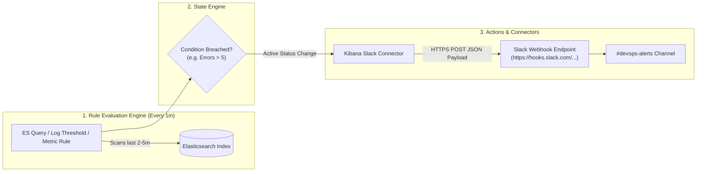

# 🔔 Production Guide: Kibana Dashboards & Slack Alerting Integration

> **Scope**: Building production-grade Kibana Lens dashboards, automating dashboards via GitOps/API, integrating Slack alerts with Incoming Webhooks, designing actionable alert payloads, and preventing alert fatigue.

---

## 📑 Table of Contents
1. [Architecture: Alerting & Actions Framework](#1-architecture-alerting--actions-framework)
2. [Building Production DevOps Dashboards with Kibana Lens](#2-building-production-devops-dashboards-with-kibana-lens)
   - [The 4 Essential DevOps Panels](#21-the-4-essential-devops-panels)
   - [Step-by-Step UI Creation Guide](#22-step-by-step-ui-creation-guide)
   - [Automating Dashboards via GitOps (Saved Objects API)](#23-automating-dashboards-via-gitops-saved-objects-api)
3. [Integrating Alerts with Slack (Step-by-Step)](#3-integrating-alerts-with-slack-step-by-step)
   - [Step 1: Create Slack Incoming Webhook](#31-step-1-create-slack-incoming-webhook)
   - [Step 2: Create Slack Connector in Kibana (UI & API)](#32-step-2-create-slack-connector-in-kibana-ui--api)
   - [Step 3: Create Alerting Rule & Wire to Slack (UI & API)](#33-step-3-create-alerting-rule--wire-to-slack-ui--api)
   - [Step 4: Design Actionable Slack Messages (Mustache Formatting)](#34-step-4-design-actionable-slack-messages-mustache-formatting)
4. [SRE Alerting Hygiene & Best Practices](#4-sre-alerting-hygiene--best-practices)
   - [Preventing Alert Storms & Fatigue](#41-preventing-alert-storms--fatigue)
   - [Snoozing, Muting & Acknowledging Alerts](#42-snoozing-muting--acknowledging-alerts)
5. [Hands-On Lab: Test Your Slack Alert End-to-End](#5-hands-on-lab-test-your-slack-alert-end-to-end)

---

## 1. Architecture: Alerting & Actions Framework

Kibana provides an event-driven Alerting & Actions engine decoupled from Elasticsearch queries:



### Core Concepts:
- **Alerting Rule**: Defines *when* to alert (e.g. check `elk-logstash-*` every 1 minute for documents where `log.level == "ERROR" > 5`).
- **Connector**: Reusable credentialed integration channel (Slack, Webhook, PagerDuty, Email, Jira).
- **Action**: The link between a Rule and a Connector, containing message templates populated by Mustache dynamic variables.
- **Action Group**: Lifecycle states (`Recovered`, `Fired`, `Warning`). Actions can trigger only when the state changes to prevent alert storms.

---

## 2. Building Production DevOps Dashboards with Kibana Lens

A great observability dashboard answers three questions within 5 seconds:
1. *Is there an active incident right now?* (Top-level error rate / health indicators)
2. *Which microservice is failing?* (Breakdown by `service.name` or `kubernetes.container.name`)
3. *What is the exact error?* (Embedded live log stream with filtered columns)

---

### 2.1. The 4 Essential DevOps Panels

```text
+-----------------------------------------------------------------------------------+
|  [Panel 1: Error Rate Gauge]        |  [Panel 2: Top Failing Services (Donut)]     |
|  ERROR %: 4.8% (Target < 1%)        |  - sample-logger: 78%                        |
|  Status: WARNING                     |  - payment-api: 22%                          |
+-----------------------------------------------------------------------------------+
|  [Panel 3: Log Volume Over Time by Severity (Stacked Bar Chart)]                   |
|  [Bars partitioned by INFO (Green), WARN (Yellow), ERROR (Red) over time]          |
+-----------------------------------------------------------------------------------+
|  [Panel 4: Live Filtered Error Log Stream (Discover Table Embed)]                  |
|  Time | Service | Level | Message | Order ID | Error Code                          |
+-----------------------------------------------------------------------------------+
```

---

### 2.2. Step-by-Step UI Creation Guide

#### 1. Open Dashboard Hub
1. In Kibana, open the menu (☰) $\to$ **Analytics** $\to$ **Dashboard**.
2. Click **Create new dashboard**.

#### 2. Create Panel 1: Log Volume by Level (Stacked Bar Chart)
1. Click **Create visualization** (opens **Lens**).
2. Ensure Data View is set to **`elk-*`** (or `elk-logstash-*`).
3. **Configuration**:
   - Drag **`@timestamp`** to the **Horizontal axis** (X-axis).
   - Drag **`Records`** (Count) to the **Vertical axis** (Y-axis).
   - Drag **`log.level`** into the **Break down by** field.
   - Set Chart type to **Stacked Bar**.
   - Customize colors: Click the color swatch next to `ERROR` $\to$ Red, `WARN` $\to$ Orange/Yellow, `INFO` $\to$ Green.
4. Click **Save and return** (Title: `Log Ingestion Volume by Severity`).

#### 3. Create Panel 2: Top Failing Microservices (Donut Chart)
1. Click **Create visualization**.
2. Top search bar: Enter filter: `log.level : "ERROR"`.
3. Set Chart Type (top dropdown) to **Donut**.
4. Drag **`service.name`** into **Slice by**.
5. Metric: `Count of records`.
6. Click **Save and return** (Title: `Top Erroring Services`).

#### 4. Create Panel 3: Error Rate Percentage (Metric Gauge)
1. Click **Create visualization**.
2. Set Chart Type to **Metric**.
3. In the formula editor, enter:
   ```text
   count(kql='log.level : "ERROR"') / count()
   ```
4. Format: Set Value format to **Percent** (`0.0%`).
5. Color palette: Set green if $< 1\%$, yellow if $1-5\%$, red if $> 5\%$.
6. Click **Save and return** (Title: `Application Error Rate`).

#### 5. Create Panel 4: Live Filtered Log Stream (Discover Embed)
1. Click **Add from library** (or Save your Discover view).
2. Choose your saved search or embed Discover directly with columns:
   - `@timestamp`, `service.name`, `log.level`, `message`, `order_id`.
3. Position at the bottom spanning full width.
4. Set top-right auto-refresh to **5 seconds**.
5. Click **Save** in the top navigation bar to save the complete Dashboard (`[DevOps] Kubernetes ELK Observability`).

---

### 2.3. Automating Dashboards via GitOps (Saved Objects API)

In modern CI/CD, dashboards are stored in git as JSON/NDJSON and automatically pushed to Kibana on deployment.

#### Exporting Dashboard to File:
```bash
ES_PWD=$(kubectl get secret -n logging elasticsearch-master-credentials -o jsonpath="{.data.password}" | base64 --decode)

curl -sk -u "elastic:$ES_PWD" -H "kbn-xsrf: true" \
  -X POST "http://localhost:5601/api/saved_objects/_export" \
  -H "Content-Type: application/json" \
  -d '{
    "type": ["dashboard"],
    "includeReferencesDeep": true
  }' > k8s-dashboard-export.ndjson
```

#### Importing Dashboard via CI/CD Pipeline:
```bash
curl -sk -u "elastic:$ES_PWD" -H "kbn-xsrf: true" \
  -X POST "http://localhost:5601/api/saved_objects/_import?overwrite=true" \
  -H "Content-Type: multipart/form-data" \
  -F file=@k8s-dashboard-export.ndjson
```

---

## 3. Integrating Alerts with Slack (Step-by-Step)

---

### 3.1. Step 1: Create Slack Incoming Webhook
1. Go to [Slack API: Your Apps](https://api.slack.com/apps).
2. Click **Create New App** $\to$ Select **From scratch**.
3. Name your app (e.g. `Kubernetes-Alertmanager-Kibana`) and pick your Slack Workspace.
4. Under **Add features and functionality**, click **Incoming Webhooks**.
5. Toggle **Activate Incoming Webhooks** to **On**.
6. Click **Add New Webhook to Workspace** at the bottom.
7. Select the target channel (e.g. `#devops-alerts` or `#incidents`) and click **Allow**.
8. **Copy the Webhook URL**:
   `https://hooks.slack.com/services/YOUR/WORKSPACE/WEBHOOK_URL`

---

### 3.2. Step 2: Create Slack Connector in Kibana (UI & API)

#### Option A: Via Kibana UI
1. In Kibana, open Menu (☰) $\to$ **Management** $\to$ **Stack Management**.
2. Under **Alerts and Insights**, click **Connectors**.
3. Click **Create connector** $\to$ Choose **Slack**.
4. Fill in:
   - **Name**: `Slack - #devops-alerts`
   - **Webhook URL**: Paste your copied Slack webhook URL.
5. Click **Save**.

#### Option B: Programmatically via Kibana REST API (DevOps Automation)
Run this command from your terminal:

```bash
ES_PWD=$(kubectl get secret -n logging elasticsearch-master-credentials -o jsonpath="{.data.password}" | base64 --decode)
KIBANA_POD=$(kubectl get pod -n logging -l app=kibana -o jsonpath='{.items[0].metadata.name}')

SLACK_WEBHOOK_URL="https://hooks.slack.com/services/YOUR/WORKSPACE/WEBHOOK_URL"

kubectl exec -n logging "$KIBANA_POD" -- curl -sk -u "elastic:$ES_PWD" \
  -X POST "http://localhost:5601/api/actions/connector" \
  -H "Content-Type: application/json" \
  -H "kbn-xsrf: true" \
  -d "{
    \"name\": \"Slack - #devops-alerts\",
    \"connector_type_id\": \".slack\",
    \"config\": {
      \"webhookUrl\": \"$SLACK_WEBHOOK_URL\"
    }
  }"
```
*Note the returned `"id"` (e.g. `c4b12345-slack-connector-id`), which will be wired into your Alert Rule in Step 3.*

---

### 3.3. Step 3: Create Alerting Rule & Wire to Slack (UI & API)

#### Option A: Via Kibana UI
1. Navigate to **Management** $\to$ **Rules**.
2. Click **Create rule**.
3. **Details**:
   - **Name**: `[Production Alert] High Application Error Rate`
   - **Tags**: `devops`, `k8s`, `errors`
   - **Check every**: `1m`, **Look back**: `2m`
4. **Rule Type**: Select **Elasticsearch query**.
5. **Query Condition**:
   - **Index**: `elk-logstash-*`
   - **Query**:
     ```json
     {
       "query": {
         "bool": {
           "filter": [
             { "term": { "log.level": "ERROR" } }
           ]
         }
       }
     }
     ```
   - **Threshold**: `IS ABOVE 5` documents.
6. **Actions**:
   - Select **Connector**: `Slack - #devops-alerts`.
   - **Action Frequency**: `On status change` *(or `Summary every 1m`)*.
   - **Message**: Copy the rich Mustache template below.
7. Click **Save**.

#### Option B: Programmatically via API
```bash
CONNECTOR_ID="<YOUR_SLACK_CONNECTOR_ID>"

kubectl exec -n logging "$KIBANA_POD" -- curl -sk -u "elastic:$ES_PWD" \
  -X POST "http://localhost:5601/api/alerting/rule" \
  -H "Content-Type: application/json" \
  -H "kbn-xsrf: true" \
  -d "{
    \"name\": \"[DevOps Alert] High Application Error Rate\",
    \"consumer\": \"stackAlerts\",
    \"rule_type_id\": \".es-query\",
    \"schedule\": { \"interval\": \"1m\" },
    \"params\": {
      \"index\": [\"elk-logstash-*\"],
      \"timeField\": \"@timestamp\",
      \"esQuery\": \"{\\\"query\\\":{\\\"bool\\\":{\\\"filter\\\":[{\\\"term\\\":{\\\"log.level\\\":\\\"ERROR\\\"}}]}}}\",
      \"threshold\": [5],
      \"thresholdComparator\": \">\",
      \"timeWindowSize\": 2,
      \"timeWindowUnit\": \"m\",
      \"size\": 10,
      \"searchType\": \"esQuery\"
    },
    \"notify_when\": \"onActionGroupChange\",
    \"actions\": [
      {
        \"group\": \"query matched\",
        \"id\": \"$CONNECTOR_ID\",
        \"params\": {
          \"message\": \"🚨 *CRITICAL ALERT: High Error Rate Detected!*\n*Rule*: {{rule.name}}\n*Threshold*: > 5 errors in 2m\n*Total Errors*: {{context.matchingDocuments}}\n*Kibana URL*: {{kibanaBaseUrl}}\"
        }
      }
    ]
  }"
```

---

### 3.4. Step 4: Design Actionable Slack Messages (Mustache Formatting)

A good alert does not just say *"Error happened"*; it provides the microservice name, the error count, and a direct link to the logs so the on-call engineer can triage immediately.

#### Production Slack Block Kit / Mustache Template:
```text
🚨 *[CRITICAL] High Error Rate Detected on Kubernetes*

• *Rule Triggered*: `{{rule.name}}`
• *Cluster*: `observability-k8s`
• *Namespace*: `default`
• *Error Count in last 2m*: `{{context.matchingDocuments}}`
• *Trigger Condition*: Errors exceeded threshold of `{{context.conditions}}`

📋 *Runbook Action*:
1. Check the latest container stderr logs in Kibana.
2. If payments/database errors persist, check DB connection pool metrics.

🔗 *Direct Links*:
• <{{kibanaBaseUrl}}/app/discover#/?_a=(query:(language:kuery,query:'log.level:%20ERROR'))|🔍 Open Filtered Logs in Kibana Discover>
• <{{kibanaBaseUrl}}/app/dashboards#/view/k8s-elk-observability|📊 View Kubernetes Master Dashboard>
```

---

## 4. SRE Alerting Hygiene & Best Practices

### 4.1. Preventing Alert Storms & Fatigue
- **Notify On Status Change (`onActionGroupChange`)**: Never configure alerts to spam Slack every 60 seconds if the error condition remains active. Configure notifications to trigger **once when entering ALERTING**, and **once when RECOVERED**.
- **Sliding Time Windows**: Avoid instant 10-second spikes triggering alerts. Use a minimum window of 2 to 5 minutes to filter out transient network retries.
- **Deduplication**: Group alerts by `service.name` or `kubernetes.pod.name` so 50 crashed pods trigger 1 grouped notification, not 50 individual Slack pings.

### 4.2. Snoozing, Muting & Acknowledging Alerts
During maintenance windows or known deployments:
- **Mute**: Silences actions from sending Slack notifications while still recording evaluation metrics.
  ```bash
  # Mute all actions for a rule via API
  curl -sk -u "elastic:$ES_PWD" -H "kbn-xsrf: true" \
    -X POST "http://localhost:5601/api/alerting/rule/<RULE_ID>/_mute_all"
  ```
- **Snooze**: Pauses alerts for a specified duration (e.g. 1 hour) and automatically unmutes afterwards.

---

## 5. Hands-On Lab: Test Your Slack Alert End-to-End

To verify your Slack alerting integration in real-time:

### 1. Confirm `sample-logger` is running
The sample app generates continuous errors every few seconds:
```bash
kubectl get pods -l app=sample-logger
```

### 2. Verify Alert Rule Execution in Kibana
Check the rule execution logs:
```bash
curl -sk -u "elastic:$ES_PWD" -H "kbn-xsrf: true" \
  "http://localhost:5601/api/alerting/rules/_find" | jq '.data[] | {name: .name, status: .execution_status}'
```
*Expected output:*
```json
{
  "name": "[DevOps Alert] High Application Error Rate",
  "status": {
    "status": "ok",
    "last_execution_date": "2026-10-18T16:36:28.236Z"
  }
}
```

### 3. Check Your Slack Channel
Within 1-2 minutes of the error threshold breach, the formatted alert card will arrive in your designated Slack channel with clickable deep-links to your Kibana Discover view!
