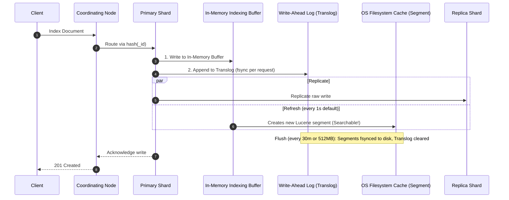
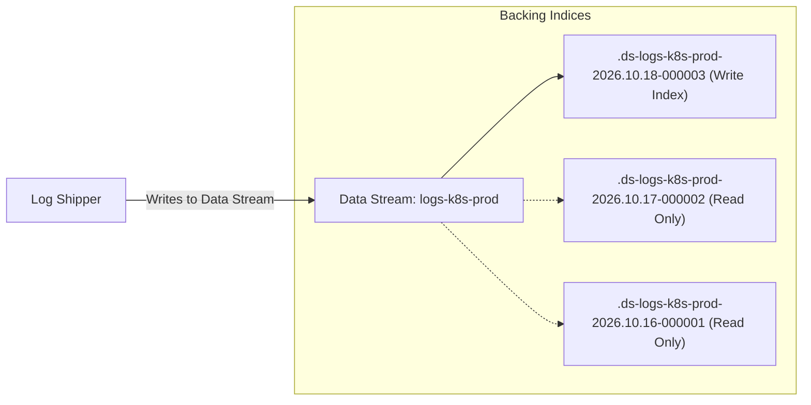
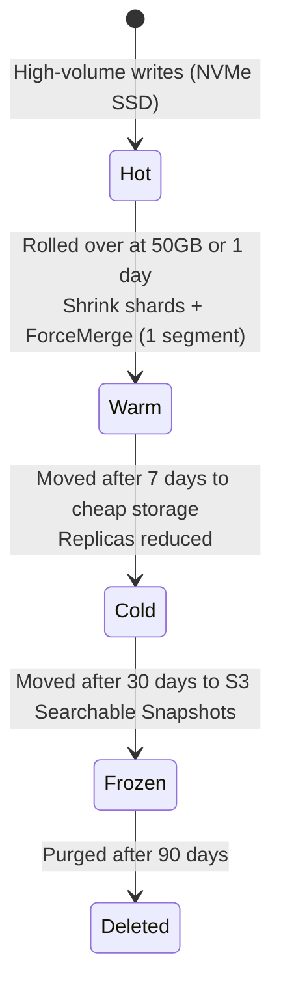

# 🎓 Senior DevOps & SRE Master Guide: ELK & EFK Observability

> **Target Audience**: DevOps Engineers, Senior SREs, and Platform Engineers.  
> **Scope**: Deep theoretical internals, production sizing math, architecture design, disaster recovery runbooks, log transformation pipelines, and real-world hands-on scenarios.

---

## 📑 Master Table of Contents
1. [Core Elasticsearch Internals (The "Under the Hood" Theory)](#1-core-elasticsearch-internals-the-under-the-hood-theory)
   - [Lucene Inverted Index, Segments & Immutability](#11-lucene-inverted-index-segments--immutability)
   - [The Life of a Write Request (Buffer, Translog, Refresh vs. Flush)](#12-the-life-of-a-write-request)
   - [Cluster Topology & Node Roles](#13-cluster-topology--node-roles)
   - [Sharding Math, Sizing Rules & The Over-Sharding Trap](#14-sharding-math-sizing-rules--the-over-sharding-trap)
   - [JVM Heap Tuning & The 32 GB Compressed OOPs Limit](#15-jvm-heap-tuning--the-32-gb-compressed-oops-boundary)
2. [Data Lifecycle & Architecture: Hot-Warm-Cold-Frozen & Data Streams](#2-data-lifecycle--architecture-hot-warm-cold-frozen--data-streams)
   - [Data Streams vs. Classic Indices](#21-data-streams-vs-classic-indices)
   - [Index Lifecycle Management (ILM) in Practice](#22-index-lifecycle-management-ilm-in-practice)
   - [Searchable Snapshots & Object Storage Tiering](#23-searchable-snapshots--object-storage-tiering)
3. [Shipper Architecture: Fluent Bit vs. Filebeat vs. Logstash](#3-shipper-architecture-fluent-bit-vs-filebeat-vs-logstash)
   - [Architectural Trade-offs & Deep Comparison](#31-architectural-trade-offs--deep-comparison)
   - [Backpressure, Memory Buffering & Persistent Queues](#32-backpressure-memory-buffering--persistent-queues)
   - [Multiline Stack Traces Handling (Java, Python, Go)](#33-multiline-stack-traces-handling)
4. [Elastic Common Schema (ECS) & Mapping Hygiene](#4-elastic-common-schema-ecs--mapping-hygiene)
   - [Dynamic Mapping Disasters & Mapping Explosion Prevention](#41-dynamic-mapping-disasters--mapping-explosion)
   - [Text vs. Keyword vs. Wildcard Types](#42-text-vs-keyword-vs-wildcard-types)
   - [ECS Core Conventions for Microservices](#43-ecs-core-conventions)
5. [Senior DevOps Troubleshooting & Incident Runbooks](#5-senior-devops-troubleshooting--incident-runbooks)
   - [Runbook 1: Cluster Health is RED or YELLOW (Shard Allocation Failures)](#51-runbook-1-cluster-health-is-red-or-yellow)
   - [Runbook 2: Disk Watermarks Tripped & Read-Only Floodstage Lock](#52-runbook-2-disk-watermarks-tripped--floodstage-lock)
   - [Runbook 3: Circuit Breaker Exceptions & JVM Heap Pressure](#53-runbook-3-circuit-breaker-exceptions--jvm-heap-pressure)
   - [Runbook 4: Logstash / Shipper Backpressure & Dropped Logs](#54-runbook-4-shipper-backpressure--dropped-logs)
   - [Runbook 5: "Kibana Server Is Not Ready Yet" (HTTP 503)](#55-runbook-5-kibana-server-is-not-ready-yet)
6. [Advanced Querying: KQL, Query DSL, and ES|QL](#6-advanced-querying-kql-query-dsl-and-esql)
   - [Kibana Query Language (KQL) Production Cheat-Sheet](#61-kql-production-cheat-sheet)
   - [Elasticsearch Query DSL Filters vs. Scoring](#62-query-dsl-filters-vs-scoring)
   - [Modern ES|QL (Piped Query Engine) for Analytics](#63-modern-esql-for-analytics)
7. [Enterprise Security, RBAC & Multi-Tenancy](#7-enterprise-security-rbac--multi-tenancy)
   - [TLS Architecture: Transport (9300) vs. REST (9200)](#71-tls-architecture)
   - [Kibana Spaces, Document-Level (DLS) & Field-Level Security (FLS)](#72-kibana-spaces-dls--fls)
8. [Real-World Hands-on Lab Scenarios to Practice](#8-real-world-hands-on-lab-scenarios-to-practice)

---

## 1. Core Elasticsearch Internals (The "Under the Hood" Theory)

### 1.1. Lucene Inverted Index, Segments & Immutability
Elasticsearch is built on top of **Apache Lucene**. Each Elasticsearch shard is a fully functional Lucene index.

- **Inverted Index**: Instead of searching text line-by-line (like `grep`), Lucene splits text into tokens (terms) and builds a sorted index pointing to the document IDs containing each term:
  ```text
  Term:        Document IDs:
  "timeout" -> [Doc #12, Doc #45, Doc #89]
  "payment" -> [Doc #12, Doc #33]
  ```
- **Immutable Segments**: Lucene writes data to disk in files called **Segments**. Once written to disk, **a segment is completely immutable (never modified)**.
  - *Why immutable?* No file locking needed, allows aggressive OS page caching, lock-free concurrent searches, and predictable compression.
  - *How do updates/deletes work?* A delete simply writes the Doc ID to a `.del` bitset file. An update is an atomic delete + insert of a new document into a new segment.
  - *Segment Merge*: Lucene periodically merges small segments into larger ones in the background, purging deleted documents and reclaiming disk space.

### 1.2. The Life of a Write Request
When a document is indexed via `POST /index/_doc`:



- **Refresh (`refresh_interval`, default `1s`)**:
  - Moves documents from the JVM in-memory buffer to a new Lucene segment in the OS page cache.
  - **Once refreshed, the document is visible to search queries ("Near Real-Time Search")**.
  - *DevOps Tuning*: In heavy log ingestion pipelines, refresh every 1s causes segment explosion and CPU waste. Increase to `refresh_interval: "30s"` or `"60s"` for massive throughput gains.
- **Flush (Default: 30 minutes or 512MB translog)**:
  - Executes an `fsync` of OS page cache segments down to physical disk.
  - Truncates the Translog once the segments are permanently committed.

---

### 1.3. Cluster Topology & Node Roles
In small clusters, a single node handles everything. In high-volume production, **split node roles** to isolate workloads:

| Node Role | Responsibility | Resource Requirements |
| :--- | :--- | :--- |
| `master` | Maintains cluster state, creates/deletes indices, tracks node joins/leaves. | Low CPU, Moderate RAM, High Network stability, Fast SSD. **Never run heavy search/indexing here!** |
| `data_hot` | Ingests active, high-volume logs; handles immediate searches. | High NVMe SSD I/O, High CPU, Fast RAM. |
| `data_warm` | Read-only past logs (e.g. 7-30 days old). | Lower CPU, Cost-effective SSD / HDD, High Storage density. |
| `data_cold` / `data_frozen` | Long-term archival logs (e.g. 30-365 days); searches backed by S3 snapshots. | Low CPU/RAM; backed by Object Storage. |
| `ingest` | Runs Ingest Node pipelines (Grok, dissect, geoip) before indexing. | High CPU, low storage. Offloads CPU spikes from data nodes. |
| `coordinating` | Acts as a smart load balancer; parses queries, scatters to shards, gathers & aggregates results. | High RAM, High Network bandwidth, zero persistent disk. |

---

### 1.4. Sharding Math, Sizing Rules & The Over-Sharding Trap

> [!WARNING]
> **The #1 Mistake of Junior DevOps Engineers**: Creating an index per service per day with 5 primary shards and 1 replica. Within 30 days, a tiny 10GB dataset has 3,000 shards, consuming the entire JVM Heap and crashing the cluster!

#### Golden Rules of Shard Sizing
1. **Target Shard Size for Logs/Observability**: **20 GB to 50 GB per shard**.
2. **JVM Heap Shard Ratio**: Maintain fewer than **20 shards per 1 GB of JVM heap**.  
   *(A node with 16 GB JVM Heap should host at most $16 \times 20 = 320$ shards across all its indices).*
3. **Primary Shards per Index**:
   - For daily indices < 20 GB total volume: **1 Primary Shard** is optimal.
   - Formula: $\text{Primary Shards} = \lceil \frac{\text{Daily Ingestion Volume (GB)}}{40 \text{ GB}} \rceil$

#### The Cost of Over-Sharding
- Every Lucene segment keeps its term dictionary, doc values metadata, and bloom filters inside the JVM Heap.
- Even if an index has 0 documents, its shard metadata still consumes ~0.5 KB to 4 KB of JVM heap permanently.
- A cluster with 5,000 idle shards can easily waste 10–12 GB of JVM heap just tracking empty files.

---

### 1.5. JVM Heap Tuning & The 32 GB Compressed OOPs Boundary

#### Rule 1: Allocate 50% of System RAM to JVM Heap (Never More)
- Elasticsearch needs JVM Heap for query caching, aggregations, cluster state, and indexing buffers.
- **Lucene relies completely on the Linux OS Page Cache** (Off-Heap) to cache raw segment files and inverted indices. If you give 90% RAM to the JVM, Lucene disk I/O crawls and search latency skyrockets!

#### Rule 2: Never Exceed 31-32 GB Heap (The "Compressed OOPs" Boundary)
- In 64-bit Java, pointers are 64 bits. However, the JVM uses **Compressed Object Pointers (Compressed OOPs)** to encode memory addresses in 32 bits, saving up to 50% memory.
- Compressed OOPs only work up to approximately **31.5 GB** (depending on the JDK).
- If you allocate `33 GB` of Heap:
  - Compressed OOPs are turned off!
  - Pointers jump from 32-bit to 64-bit.
  - A 33 GB Heap actually has **less usable memory** than a 30 GB Heap because all memory references double in size, plus garbage collection (GC) pause times dramatically increase!
- **Formula**:
  $$\text{Max JVM Heap} = \min(0.5 \times \text{Host RAM}, 31 \text{ GB})$$

---

## 2. Data Lifecycle & Architecture: Hot-Warm-Cold-Frozen & Data Streams

### 2.1. Data Streams vs. Classic Indices
In modern Elasticsearch (7.9+ / 8.x), **Data Streams** are the standard for append-only time-series data (logs, metrics, traces).



- Clients always write to a single endpoint: `POST /logs-k8s-prod/_doc`.
- Elasticsearch automatically routes writes to the latest write-backing index.
- Reads query all backing indices automatically.
- Requires an `@timestamp` field in every document.

---

### 2.2. Index Lifecycle Management (ILM) in Practice

ILM automates the transition of indices through life stages to save costs:



#### Production ILM Policy Definition:
```json
PUT _ilm/policy/devops_log_lifecycle_policy
{
  "policy": {
    "phases": {
      "hot": {
        "min_age": "0ms",
        "actions": {
          "rollover": {
            "max_primary_shard_size": "50gb",
            "max_age": "1d"
          },
          "set_priority": { "priority": 100 }
        }
      },
      "warm": {
        "min_age": "2d",
        "actions": {
          "forcemerge": { "max_num_segments": 1 },
          "shrink": { "number_of_shards": 1 },
          "allocate": { "number_of_replicas": 0 },
          "set_priority": { "priority": 50 }
        }
      },
      "cold": {
        "min_age": "14d",
        "actions": {
          "set_priority": { "priority": 0 }
        }
      },
      "delete": {
        "min_age": "30d",
        "actions": {
          "delete": {}
        }
      }
    }
  }
}
```

---

## 3. Shipper Architecture: Fluent Bit vs. Filebeat vs. Logstash

### 3.1. Architectural Trade-offs & Deep Comparison

```text
Lightweight Edge                                                   Heavy Centralized
[Fluent Bit] ------------------------> [Filebeat] --------------------> [Logstash]
~20-40 MB RAM                        ~40-80 MB RAM                     ~1-2 GB RAM (JVM)
C-based binary                        Go-based binary                   JRuby / JVM
High performance, low footprint       Best ECS & Elastic native         Rich plugins, custom Grok
```

| Criteria | Fluent Bit | Filebeat | Logstash |
| :--- | :--- | :--- | :--- |
| **Language** | C (Native compiled) | Go (Native compiled) | JRuby / Java (JVM) |
| **Footprint per Node** | ~25 MB RAM, <2% CPU | ~50 MB RAM, <3% CPU | ~1-2 GB RAM, 20-50% CPU |
| **Placement** | Kubernetes DaemonSet | Kubernetes DaemonSet | Centralized Deployment/StatefulSet |
| **Parsing Capability** | Regex, JSON, simple Lua | Processors, Decoders, Modules | 200+ plugins, complex Grok, conditionals, lookups |
| **Backpressure Control** | Memory chunk limits + Disk buffer | Spooler, Lumberjack protocol | Persistent Disk Queue (PQ) |
| **Best Used For** | Kubernetes node log extraction | Kubernetes node log extraction + Elastic integration | Complex aggregation, field transformation, legacy format conversion |

---

### 3.2. Backpressure, Memory Buffering & Persistent Queues

When Elasticsearch slows down (due to heavy indexing, garbage collection, or node restart), the log shipper must handle backpressure without crashing the node or losing logs.

#### 1. Fluent Bit Disk Buffering (`storage.type disk`)
By default, Fluent Bit buffers logs in memory. Under backpressure, if memory hits `Mem_Buf_Limit`, it stops reading `/var/log/containers/` or drops logs.  
**Production Fix**:
```ini
[INPUT]
    Name tail
    Path /var/log/containers/*.log
    storage.type disk
    Mem_Buf_Limit 10MB
```

#### 2. Logstash Persistent Queues (PQ)
Logstash defaults to an in-memory queue of 20 events. If the pod restarts or OOMs during a network glitch, in-flight events are lost.  
**Production Fix in `logstash.yml`**:
```yaml
queue.type: persisted
queue.max_bytes: 4gb
queue.checkpoint.writes: 1024
path.queue: /usr/share/logstash/data/queue
```

---

### 3.3. Multiline Stack Traces Handling
A stack trace (Java Exception, Python Traceback, Golang Panic) consists of multiple lines. By default, container runtimes emit each line as an independent log event, breaking your search.

#### Fluent Bit Multiline Parser:
In `fluentbit-values.yaml`:
```ini
[FILTER]
    Name multiline
    Match kube.*
    multiline.key_content log
    multiline.parser java, python, go
```

#### Filebeat Multiline Config:
In `filebeat-values.yml`:
```yaml
multiline.type: pattern
multiline.pattern: '^[0-9]{4}-[0-9]{2}-[0-9]{2}' # Regex matching timestamp start
multiline.negate: true
multiline.match: after
```

---

## 4. Elastic Common Schema (ECS) & Mapping Hygiene

### 4.1. Dynamic Mapping Disasters & Mapping Explosion
By default, Elasticsearch creates mappings dynamically. If an application prints JSON logs with dynamic keys (e.g. `{"user_12345": "data"}`, `{"order_9876": "paid"}`), Elasticsearch creates a new field in the cluster mapping for every single key!

- **Mapping Explosion**: Once an index exceeds `index.mapping.total_fields.limit` (default: 1,000 fields), Elasticsearch rejects new writes with `illegal_argument_exception: Limit of total fields [1000] has been exceeded`.
- **Cluster State Saturation**: The cluster state contains the mapping of every index. When cluster state grows from 1MB to 100MB+, propagating state changes across nodes causes seconds-long network pauses and split-brain warnings.

#### Prevention Strategies:
1. **Never index arbitrary JSON directly into root**:
   Always namespace parsed objects or set `"dynamic": "runtime"` or `"dynamic": false`.
2. **Increase field limits only with careful consideration**:
   ```json
   PUT /my-index/_settings
   { "index.mapping.total_fields.limit": 2000 }
   ```

---

### 4.2. Text vs. Keyword vs. Wildcard Types

Understanding field types determines query speed and memory footprint:

| Type | Analyzed? | Data Structure | Best Used For | Example Query |
| :--- | :--- | :--- | :--- | :--- |
| **`keyword`** | No (Exact match) | Doc Values & Inverted Index | Enums, IDs, hostnames, HTTP codes, IP, status | `status: "ERROR"`, Terms aggregations |
| **`text`** | Yes (Tokenizer, Lowercase, Stemming) | Inverted Index | Unstructured messages, stack traces, descriptions | Full-text search: `message: "timed out"` |
| **`wildcard`** | Yes (N-gram sub-strings) | Automated N-gram index | Grep-like queries on machine logs, URLs, error paths | `path: *service/payment*` |

> [!TIP]
> Avoid running aggregations on `text` fields. Running aggregations on `text` loads fielddata into JVM heap, triggering the Fielddata Circuit Breaker. Always aggregate on `keyword` multi-fields (e.g. `log.level` or `message.keyword`).

---

### 4.3. ECS Core Conventions
Standardizing fields enables unified dashboards and pre-built alerts:
- `service.name`: Name of the microservice (e.g. `payment-api`)
- `service.version`: Git commit SHA or version tag
- `log.level`: Normalized level (`INFO`, `WARN`, `ERROR`, `DEBUG`)
- `error.code` & `error.message`: Machine-readable error identifier and explanation
- `trace.id` & `span.id`: Distributed tracing context (W3C Trace Context)
- `host.name`: Node name where the container ran
- `kubernetes.pod.name` & `kubernetes.namespace`: Container platform metadata

---

## 5. Senior DevOps Troubleshooting & Incident Runbooks

### 5.1. Runbook 1: Cluster Health is RED or YELLOW

#### Diagnostics:
```bash
# 1. Check which indices are causing the issue
curl -sk -u "elastic:$ES_PWD" "https://localhost:9200/_cat/indices?v&health=yellow,red"

# 2. Check unassigned shards explanation (THE MOST CRITICAL API)
curl -sk -u "elastic:$ES_PWD" "https://localhost:9200/_cluster/allocation/explain?pretty"
```

#### Common Root Causes & Remediations:
1. **Reason: `ALLOCATION_FAILED` (Disk watermark or corrupted segment)**:
   - Check `unassigned_info.details` in the explain API response.
   - If disk space is freed, trigger retry:
     ```bash
     curl -sk -u "elastic:$ES_PWD" -X POST "https://localhost:9200/_cluster/reroute?retry_failed=true"
     ```
2. **Reason: Single-Node Cluster has 1 Replica configured (Cluster YELLOW)**:
   - Run:
     ```bash
     curl -sk -u "elastic:$ES_PWD" -X PUT "https://localhost:9200/*/_settings" \
       -H "Content-Type: application/json" -d '{"index.number_of_replicas": 0}'
     ```

---

### 5.2. Runbook 2: Disk Watermarks Tripped & Floodstage Lock

Elasticsearch enforces 3 disk thresholds:
- **Low Watermark (85%)**: Elasticsearch stops allocating new shards to this node.
- **High Watermark (90%)**: Elasticsearch attempts to relocate existing shards away from this node.
- **Floodstage Watermark (95%)**: Elasticsearch blocks ALL write operations across all indices on the node, locking indices into `read_only_allow_delete`.

#### Symptoms:
```text
cluster_block_exception: [TOO_MANY_REQUESTS/12/disk usage exceeded flood-stage watermark, index has read-only-allow-delete block]
```

#### Remediation Steps:
```bash
# Step 1: Free up disk space (delete old indices or expand PVC)
curl -sk -u "elastic:$ES_PWD" -X DELETE "https://localhost:9200/old-indices-*"

# Step 2: Clear the read-only block across all indices
curl -sk -u "elastic:$ES_PWD" -X PUT "https://localhost:9200/_all/_settings" \
  -H "Content-Type: application/json" \
  -d '{
    "index.blocks.read_only_allow_delete": null
  }'
```

---

### 5.3. Runbook 3: Circuit Breaker Exceptions & JVM Heap Pressure

#### Symptoms:
```text
CircuitBreakingException: [parent] Data too large, data for [<transport_request>] would be [15832967168/14.7gb], which is larger than the limit of [15032385536/13.9gb]
```

#### Diagnostics:
```bash
# Check JVM memory and Garbage Collection statistics
curl -sk -u "elastic:$ES_PWD" "https://localhost:9200/_nodes/stats/jvm?pretty"

# Check circuit breaker usage
curl -sk -u "elastic:$ES_PWD" "https://localhost:9200/_nodes/stats/breaker?pretty"
```

#### Remediation:
1. Identify expensive search/aggregation queries in slow logs (`elasticsearch_index_search_slow_log.json`).
2. Disallow expensive regex queries and increase real-memory breaker threshold if temporary:
   ```json
   PUT _cluster/settings
   {
     "persistent": {
       "indices.breaker.total.use_real_memory": true
     }
   }
   ```
3. Scale up JVM heap or add more data nodes to distribute shard memory load.

---

### 5.4. Runbook 4: Shipper Backpressure & Dropped Logs

#### Diagnostics:
```bash
# 1. Check Logstash queue backlog
kubectl exec -n logging logstash-logstash-0 -- curl -s http://localhost:9600/_node/stats/pipelines?pretty

# 2. Check Filebeat registry and dropped events
kubectl logs -n logging -l app=filebeat --tail=100 | grep -E "dropped|backoff|retry"

# 3. Check Fluent Bit output metrics
kubectl exec -n logging <fluent-bit-pod> -- curl -s http://localhost:2020/api/v1/metrics
```

#### Remediation:
- Scale out Logstash replicas (`replicas: 2` or `3`).
- Tune `pipeline.workers` to match container CPU cores.
- Increase bulk batch size: `pipeline.batch.size: 250` (or `500`).

---

### 5.5. Runbook 5: "Kibana Server Is Not Ready Yet" (HTTP 503)

#### Root Cause:
In Elasticsearch 8.x, Kibana relies on an internal service account token stored in the `.security` index. If Elasticsearch pod restarts in an environment without persistent storage or re-creates its `.security` index, the token is invalidated.

#### Quick Remediation:
```bash
# 1. Generate new token
TOKEN=$(kubectl exec -n logging elasticsearch-master-0 -- \
  /usr/share/elasticsearch/bin/elasticsearch-service-tokens create elastic/kibana kibana-token | awk '{print $4}')

# 2. Update Secret
kubectl create secret generic kibana-kibana-es-token -n logging \
  --from-literal=token="$TOKEN" \
  --dry-run=client -o yaml | kubectl apply -f -

# 3. Restart Kibana
kubectl rollout restart deployment kibana-kibana -n logging
```

---

## 6. Advanced Querying: KQL, Query DSL, and ES|QL

### 6.1. KQL Production Cheat-Sheet
KQL (Kibana Query Language) is used directly inside Kibana Discover:

```kql
# Exact match
service.name : "payment-api"

# Multiple conditions
service.name : "payment-api" and log.level : "ERROR"

# Field exists
error.code : *

# Range query (HTTP response codes)
http.response.status_code >= 500

# Substring wildcard
message : *connection*timeout*

# Negative query
not kubernetes.namespace : "kube-system"
```

---

### 6.2. Query DSL: Filters vs. Scoring
In logging and observability, **you should almost never compute relevance scores (`_score`)**. Scoring consumes significant CPU.

```json
POST /elk-logstash-*/_search
{
  "query": {
    "bool": {
      "filter": [
        { "term": { "log.level": "ERROR" } },
        { "term": { "service.name": "sample-logger" } },
        { "range": { "@timestamp": { "gte": "now-1h" } } }
      ]
    }
  }
}
```
> [!NOTE]
> Clauses placed inside `"filter"` context:
> 1. Completely bypass relevance score computation (CPU friendly).
> 2. Are automatically cached in memory by Elasticsearch bitset caches for fast re-execution!

---

### 6.3. Modern ES|QL (Piped Query Engine) for Analytics
Elasticsearch Query Language (ES|QL) introduces pipeline processing (similar to Splunk SPL or Linux pipes):

#### Example 1: Top 5 Failing Services in the last 15 minutes
```esql
FROM elk-logstash-*
| WHERE @timestamp >= NOW() - 15 MINUTES AND log.level == "ERROR"
| STATS error_count = COUNT(*) BY service.name
| SORT error_count DESC
| LIMIT 5
```

#### Example 2: Calculate P95 and P99 Latency from Application Logs
```esql
FROM elk-logstash-*
| WHERE service.name == "sample-logger" AND latency_ms IS NOT NULL
| STATS 
    avg_latency = AVG(latency_ms),
    p95_latency = PERCENTILE(latency_ms, 95),
    p99_latency = PERCENTILE(latency_ms, 99)
  BY service.name
```

---

## 7. Enterprise Security, RBAC & Multi-Tenancy

### 7.1. TLS Architecture
Elasticsearch clusters in production require two distinct TLS layers:
1. **Transport Layer (Port 9300)**: Encrypts node-to-node gossip, cluster state distribution, and shard replication. Must use mTLS with trusted CA certificates.
2. **HTTP REST Layer (Port 9200)**: Encrypts traffic between clients (Logstash, Fluent Bit, Kibana, curl) and Elasticsearch.

### 7.2. Kibana Spaces, Document-Level (DLS) & Field-Level Security (FLS)
In enterprise environments, multiple teams share the same cluster:
- **Kibana Spaces**: Creates isolated workspaces (e.g. `DevOps Space`, `Security SOC Space`, `Payments Team Space`).
- **Document-Level Security (DLS)**: Restricts a role so users can only see their own namespace's logs:
  ```json
  {
    "term": { "kubernetes.namespace": "payments" }
  }
  ```
- **Field-Level Security (FLS)**: Hides sensitive fields (e.g. `credit_card_number`, `user.token`) from general viewers.

---

## 8. Real-World Hands-on Lab Scenarios to Practice

To master this knowledge, execute these 3 real-world drills on your cluster:

### Lab Drill 1: Simulate Shard Allocation Failure & Resolve It
1. Create a test index with 5 replicas on your 1-node cluster:
   ```bash
   curl -sk -u "elastic:$ES_PWD" -X PUT "https://localhost:9200/test-unassigned" \
     -H "Content-Type: application/json" -d '{"settings": {"number_of_replicas": 5}}'
   ```
2. Verify cluster turns `yellow`:
   ```bash
   curl -sk -u "elastic:$ES_PWD" "https://localhost:9200/_cluster/health?pretty"
   ```
3. Use the allocation explain API to see why:
   ```bash
   curl -sk -u "elastic:$ES_PWD" "https://localhost:9200/_cluster/allocation/explain?pretty"
   ```
4. Remediate it by updating replicas to 0.

### Lab Drill 2: Trace Distributed Logs with `trace.id`
1. Inject synthetic logs containing a shared `trace.id`:
   ```bash
   curl -sk -u "elastic:$ES_PWD" -X POST "https://localhost:9200/elk-logstash-test/_doc" \
     -H "Content-Type: application/json" \
     -d '{"@timestamp": "2026-10-18T16:00:00Z", "service.name": "auth-service", "trace.id": "abc-123", "message": "User authenticated"}'

   curl -sk -u "elastic:$ES_PWD" -X POST "https://localhost:9200/elk-logstash-test/_doc" \
     -H "Content-Type: application/json" \
     -d '{"@timestamp": "2026-10-18T16:00:01Z", "service.name": "payment-api", "trace.id": "abc-123", "message": "Card charged successfully"}'
   ```
2. Go to Kibana Discover, query `trace.id: "abc-123"`, and observe how distributed microservice logs correlate across the entire request transaction.

### Lab Drill 3: ES|QL Live Analytics
Open Kibana $\to$ **Analytics** $\to$ **Discover** $\to$ Toggle the query mode to **ES|QL**, and run:
```esql
FROM elk-logstash-*
| STATS count = COUNT(*) BY log.level
| SORT count DESC
```
This produces an immediate aggregation table and chart without needing to build a custom Lens visualization!
