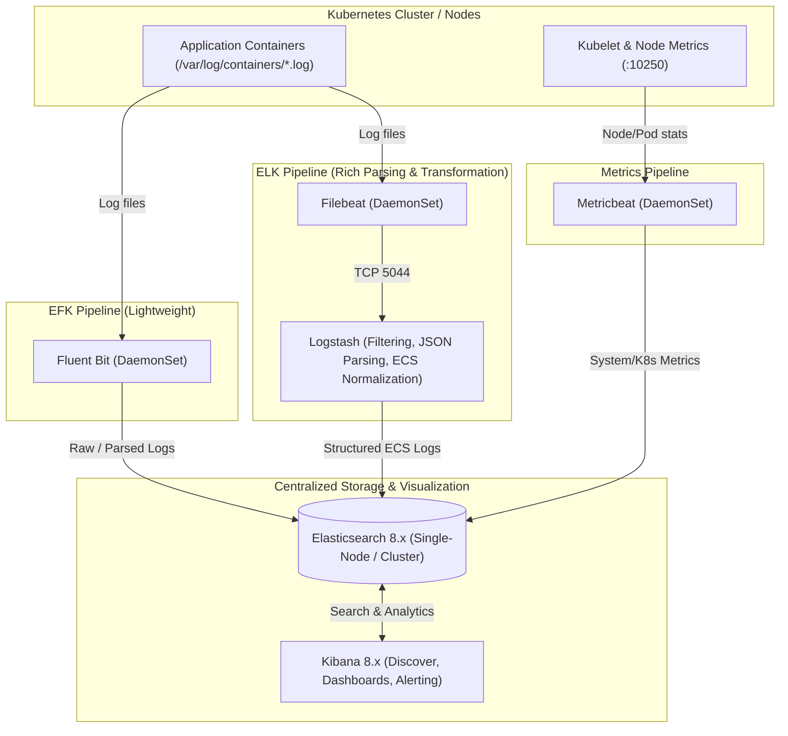

# 🚀 Complete Production Guide: Setting Up EFK and ELK Stacks from Scratch on Kubernetes

This guide documents every step, architecture decision, configuration file, and troubleshooting technique used to build and operate a fully functional **EFK** (Elasticsearch, Fluent Bit, Kibana) and **ELK** (Elasticsearch, Logstash, Filebeat, Kibana) observability platform on Kubernetes (Kind / EKS).

---

## 📑 Table of Contents
1. [Architecture Overview: EFK vs. ELK](#-1-architecture-overview-efk-vs-elk)
2. [Prerequisites & Repository Setup](#-2-prerequisites--helm-repositories)
3. [Step 1: Deploy Elasticsearch 8.x](#-3-step-1-deploy-elasticsearch-8x)
4. [Step 2: Deploy Kibana 8.x](#-4-step-2-deploy-kibana-8x)
5. [Step 3A: Deploy EFK with Fluent Bit](#-5-step-3a-option-a---efk-stack-with-fluent-bit)
6. [Step 3B: Deploy ELK with Filebeat + Logstash](#-6-step-3b-option-b---elk-stack-with-filebeat--logstash)
7. [Step 4: Deploy Metricbeat for Kubernetes Metrics](#-7-step-4-deploy-metricbeat-for-cluster--node-metrics)
8. [Step 5: Deploy Sample Logger Application](#-8-step-5-deploy-sample-application--generate-logs)
9. [Step 6: Kibana Configuration & Log Investigation](#-9-step-6-kibana-configuration--log-analysis)
10. [Step 7: Production Troubleshooting & Maintenance](#-10-step-7-production-troubleshooting--maintenance)

---

## 🏛️ 1. Architecture Overview: EFK vs. ELK



### EFK vs. ELK Comparison
| Feature | EFK (Fluent Bit) | ELK (Filebeat + Logstash) |
| :--- | :--- | :--- |
| **Log Shipper** | Fluent Bit (C-based, ultra-light ~20-50MB RAM) | Filebeat (Go-based, light ~30-60MB RAM) |
| **Log Processing** | In-engine C parsers, Lua scripts, Regex | Logstash JVM pipeline, Grok, JSON mutate, Drop rules |
| **Best For** | Resource-constrained edge/cloud nodes, simple routing | Complex enterprise log transformations, ECS schema compliance |
| **Index Pattern** | `logstash-YYYY.MM.dd` | `elk-logstash-YYYY.MM.dd` |

---

## 📦 2. Prerequisites & Helm Repositories

### 1. Create Dedicated Namespace
```bash
kubectl create namespace logging
```

### 2. Add Helm Repositories
```bash
helm repo add elastic https://helm.elastic.co
helm repo add fluent https://fluent.github.io/helm-charts
helm repo update
```

---

## 🗄️ 3. Step 1: Deploy Elasticsearch 8.x

In Elasticsearch 8.x, security (TLS and authentication) is enabled by default. On single-node environments (e.g. Kind or non-HA dev clusters), Elasticsearch reports cluster health `yellow` because replica shards cannot be assigned. We configure custom parameters to ensure smooth Helm deployments.

### Configuration: `elasticsearch-values.yml`
```yaml
replicas: 1
clusterHealthCheckParams: "wait_for_status=yellow&timeout=1s"

persistence:
  enabled: true

volumeClaimTemplate:
  storageClassName: standard
  resources:
    requests:
      storage: 5Gi

resources:
  requests:
    cpu: "500m"
    memory: "1536Mi"
  limits:
    cpu: "1000m"
    memory: "2Gi"
```

> [!NOTE]
> `clusterHealthCheckParams: "wait_for_status=yellow&timeout=1s"` prevents Helm from failing or timing out while waiting for a green cluster on a single-node deployment.

### Install Elasticsearch
```bash
helm install elasticsearch elastic/elasticsearch \
  -f elasticsearch-values.yml \
  -n logging
```

Verify deployment:
```bash
kubectl rollout status statefulset elasticsearch-master -n logging
```

### Retrieve Credentials
```bash
# Username (default: elastic)
kubectl get secret -n logging elasticsearch-master-credentials -o jsonpath="{.data.username}" | base64 --decode; echo

# Password
kubectl get secret -n logging elasticsearch-master-credentials -o jsonpath="{.data.password}" | base64 --decode; echo
```

### Fix Single-Node Shards (Turn Cluster GREEN)
By default, newly created indices request 1 replica, leaving shards unassigned on a 1-node cluster. Apply an index template with `auto_expand_replicas: "0-1"`:

```bash
ES_PWD=$(kubectl get secret -n logging elasticsearch-master-credentials -o jsonpath="{.data.password}" | base64 --decode)

kubectl exec -n logging elasticsearch-master-0 -- curl -sk -u "elastic:$ES_PWD" \
  -X PUT "https://localhost:9200/_index_template/single_node_template" \
  -H "Content-Type: application/json" \
  -d '{
    "index_patterns": ["*"],
    "template": {
      "settings": {
        "index.auto_expand_replicas": "0-1",
        "number_of_replicas": 0
      }
    },
    "priority": 100
  }'
```

Verify cluster status:
```bash
kubectl exec -n logging elasticsearch-master-0 -- curl -sk -u "elastic:$ES_PWD" "https://localhost:9200/_cluster/health?pretty"
```

---

## 📊 4. Step 2: Deploy Kibana 8.x

### Configuration: `kibana.yml`
```yaml
kibanaConfig:
  kibana.yml: |
    xpack.encryptedSavedObjects.encryptionKey: "GbxzA/TOlPiGyZqqi++HbA/2o3Q/251FD8BP0jLxgH8="

service:
  type: NodePort
  port: 5601

resources:
  requests:
    cpu: "200m"
    memory: "200Mi"
  limits:
    cpu: "1000m"
    memory: "2Gi"
```

### Install Kibana
```bash
helm install kibana elastic/kibana \
  -f kibana.yml \
  -n logging
```

### ⚠️ Common Issue: "Kibana server is not ready yet" (HTTP 503)
In Elasticsearch 8.x, Kibana connects via a service token in secret `kibana-kibana-es-token`. If Elasticsearch restarted or was re-installed, the `.security` index token must be re-issued:

```bash
# 1. Generate new token from Elasticsearch
TOKEN=$(kubectl exec -n logging elasticsearch-master-0 -- \
  /usr/share/elasticsearch/bin/elasticsearch-service-tokens create elastic/kibana kibana-token | awk '{print $4}')

# 2. Update Kubernetes secret
kubectl create secret generic kibana-kibana-es-token -n logging \
  --from-literal=token="$TOKEN" \
  --dry-run=client -o yaml | kubectl apply -f -

# 3. Restart Kibana
kubectl rollout restart deployment kibana-kibana -n logging
kubectl rollout status deployment kibana-kibana -n logging
```

### Accessing Kibana
Run port-forward:
```bash
kubectl port-forward svc/kibana-kibana 5601:5601 --address 0.0.0.0 -n logging &
```
Open in browser: `http://localhost:5601` (Username: `elastic`, Password from Step 1).

---

## ⚡ 5. Step 3A: Option A - EFK Stack with Fluent Bit

Fluent Bit runs as a DaemonSet, scraping container logs directly from `/var/log/containers/*.log` and pushing them over HTTPS to Elasticsearch.

### Configuration Highlights in `fluentbit-values.yaml`:
- **Input**:
  ```ini
  [INPUT]
      Name tail
      Path /var/log/containers/*.log
      Parser docker
      Tag kube.*
      Mem_Buf_Limit 5MB
      Skip_Long_Lines On
  ```
- **Filter**:
  ```ini
  [FILTER]
      Name kubernetes
      Match kube.*
      Kube_URL https://kubernetes.default.svc:443
      Merge_Log On
      Keep_Log Off
  ```
- **Output**:
  ```ini
  [OUTPUT]
      Name es
      Match kube.*
      Host elasticsearch-master
      Port 9200
      HTTP_User elastic
      HTTP_Passwd <YOUR_ES_PASSWORD>
      tls On
      tls.verify Off
      Logstash_Format On
      Logstash_Prefix logstash
  ```

### Install Fluent Bit
```bash
helm install fluent-bit fluent/fluent-bit -f fluentbit-values.yaml -n logging
```

Verify pod is running:
```bash
kubectl get pods -n logging -l app.kubernetes.io/name=fluent-bit
```

---

## 🪵 6. Step 3B: Option B - ELK Stack with Filebeat + Logstash

This pipeline gives enterprise-grade log processing, filtering, and normalization into Elastic Common Schema (ECS).

### 1. Configure Filebeat: `filebeat-values.yml`
Filebeat collects container logs and forwards them to Logstash port 5044:
```yaml
filebeatConfig:
  filebeat.yml: |-
    filebeat.inputs:
      - type: container
        paths:
          - /var/log/containers/*.log
        processors:
          - add_kubernetes_metadata:
              host: ${NODE_NAME}
              matchers:
                - logs_path:
                    logs_path: "/var/log/containers/"

    output.logstash:
      hosts: ["logstash-logstash:5044"]
```

### 2. Configure Logstash: `logstash-values.yml`
Logstash handles:
1. **Noise Dropping**: Drops repetitive health checks (`/healthz`, `/livez`) and heartbeat messages.
2. **JSON Parsing**: Extracts fields (`[log][level]`, `[service][name]`, `[error][code]`, `order_id`) and rewires `@timestamp` to the application's actual log timestamp.
3. **Log Level Normalization**: Categorizes plain text messages into standard levels (`ERROR`, `WARN`, `INFO`, `DEBUG`).
4. **ECS Alignment**: Sets `[service][name]` to Kubernetes container name if not provided.
5. **Secure Output**: Uses the mounted CA certificate (`elasticsearch-master-certs`) and dynamic index names `elk-logstash-%{+YYYY.MM.dd}`.

```yaml
extraEnvs:
  - name: "ELASTICSEARCH_USERNAME"
    valueFrom:
      secretKeyRef:
        name: elasticsearch-master-credentials
        key: username
  - name: "ELASTICSEARCH_PASSWORD"
    valueFrom:
      secretKeyRef:
        name: elasticsearch-master-credentials
        key: password

logstashPipeline:
  logstash.conf: |
    input {
      beats {
        port => 5044
      }
    }

    filter {
      # 1. DROP NOISE
      if [kubernetes][container][name] =~ /(fluent-bit|filebeat)/ and [message] =~ /(Non-zero metrics|DEPRECATED)/ {
        drop { }
      }
      if [message] =~ /(GET \/healthz|GET \/livez|kube-probe)/ {
        drop { }
      }

      # 2. JSON PARSER
      if [message] =~ /^\{.*\}$/ {
        json {
          source => "message"
          target => "parsed_json"
          skip_on_invalid_json => true
        }

        if [parsed_json][level] {
          mutate { add_field => { "[log][level]" => "%{[parsed_json][level]}" } }
        }
        if [parsed_json][app] {
          mutate { add_field => { "[service][name]" => "%{[parsed_json][app]}" } }
        }
        if [parsed_json][error_code] {
          mutate { add_field => { "[error][code]" => "%{[parsed_json][error_code]}" } }
        }
        if [parsed_json][order_id] {
          mutate { add_field => { "order_id" => "%{[parsed_json][order_id]}" } }
        }
        if [parsed_json][message] {
          mutate { replace => { "message" => "%{[parsed_json][message]}" } }
        }
        if [parsed_json][timestamp] {
          date {
            match => [ "[parsed_json][timestamp]", "ISO8601", "yyyy-MM-dd'T'HH:mm:ss'Z'", "yyyy-MM-dd'T'HH:mm:ss.SSSZ" ]
            target => "@timestamp"
          }
        }
      }

      # 3. LOG LEVEL NORMALIZATION
      if ![log][level] {
        if [message] =~ /(?i)(fatal|critical|error|exception|fail)/ {
          mutate { add_field => { "[log][level]" => "ERROR" } }
        } else if [message] =~ /(?i)(warn|warning)/ {
          mutate { add_field => { "[log][level]" => "WARN" } }
        } else if [message] =~ /(?i)(debug|trace)/ {
          mutate { add_field => { "[log][level]" => "DEBUG" } }
        } else {
          mutate { add_field => { "[log][level]" => "INFO" } }
        }
      }

      mutate {
        uppercase => [ "[log][level]" ]
      }

      # 4. ECS SERVICE NAME FALLBACK
      if ![service][name] and [kubernetes][container][name] {
        mutate {
          add_field => { "[service][name]" => "%{[kubernetes][container][name]}" }
        }
      }
    }

    output {
      elasticsearch {
        hosts => ["https://elasticsearch-master:9200"]
        index => "elk-logstash-%{+YYYY.MM.dd}"
        cacert => "/usr/share/logstash/config/elasticsearch-master-certs/ca.crt"
        user => '${ELASTICSEARCH_USERNAME}'
        password => '${ELASTICSEARCH_PASSWORD}'
      }
    }

secretMounts:
  - name: "elasticsearch-master-certs"
    secretName: "elasticsearch-master-certs"
    path: "/usr/share/logstash/config/elasticsearch-master-certs"

service:
  type: ClusterIP
  ports:
    - name: beats
      port: 5044
      protocol: TCP
      targetPort: 5044

resources:
  requests:
    cpu: "200m"
    memory: "200Mi"
  limits:
    cpu: "1000m"
    memory: "1536Mi"

readinessProbe:
  tcpSocket:
    port: 5044
  initialDelaySeconds: 60
  periodSeconds: 10

livenessProbe:
  tcpSocket:
    port: 5044
  initialDelaySeconds: 120
  periodSeconds: 15
```

### 3. Deploy Logstash and Filebeat
```bash
# Deploy Logstash first
helm install logstash elastic/logstash -f logstash-values.yml -n logging

# Wait for Logstash to become ready on port 5044
kubectl rollout status statefulset logstash-logstash -n logging

# Deploy Filebeat
helm install filebeat elastic/filebeat -f filebeat-values.yml -n logging
kubectl rollout status daemonset filebeat-filebeat -n logging
```

---

## 📈 7. Step 4: Deploy Metricbeat for Cluster & Node Metrics

Metricbeat collects container, pod, node, and system resource metrics directly into Elasticsearch.

### 1. Apply RBAC Permissions: `metric-rbac.yml`
```bash
kubectl apply -f metric-rbac.yml
```

### 2. Configure Metricbeat: `metric-beat-values.yml`
Includes tolerations for master/control-plane nodes, mounts the Elasticsearch CA cert, and authenticates via credentials secret:
```yaml
daemonset:
  enabled: true
  tolerations:
    - key: node-role.kubernetes.io/control-plane
      operator: Exists
      effect: NoSchedule

deployment:
  enabled: false

serviceAccount: metricbeat

extraEnvs:
  - name: ELASTICSEARCH_USERNAME
    valueFrom:
      secretKeyRef:
        name: elasticsearch-master-credentials
        key: username
  - name: ELASTICSEARCH_PASSWORD
    valueFrom:
      secretKeyRef:
        name: elasticsearch-master-credentials
        key: password

secretMounts:
  - name: elasticsearch-master-certs
    secretName: elasticsearch-master-certs
    path: /usr/share/metricbeat/certs

metricbeatConfig:
  metricbeat.yml: |
    metricbeat.modules:
      - module: kubernetes
        metricsets:
          - node
          - pod
          - container
          - system
        period: 10s
        host: ${NODE_NAME}
        hosts:
          - https://${NODE_NAME}:10250
        bearer_token_file: /var/run/secrets/kubernetes.io/serviceaccount/token
        ssl.verification_mode: none

    processors:
      - add_kubernetes_metadata:
          host: ${NODE_NAME}

    output.elasticsearch:
      hosts: ["https://elasticsearch-master:9200"]
      username: "${ELASTICSEARCH_USERNAME}"
      password: "${ELASTICSEARCH_PASSWORD}"
      ssl.certificate_authorities:
        - /usr/share/metricbeat/certs/ca.crt

resources:
  requests:
    cpu: "100m"
    memory: "100Mi"
  limits:
    cpu: "500m"
    memory: "500Mi"
```

### 3. Deploy Metricbeat
```bash
helm install metricbeat elastic/metricbeat -f metric-beat-values.yml -n logging
kubectl rollout status daemonset metricbeat-metricbeat -n logging
```

---

## 🧪 8. Step 5: Deploy Sample Application & Generate Logs

Deploy `sample-logger.yaml` in the `default` namespace to test JSON parsing and alerting:
```yaml
apiVersion: apps/v1
kind: Deployment
metadata:
  name: sample-logger
  namespace: default
  labels:
    app: sample-logger
spec:
  replicas: 1
  selector:
    matchLabels:
      app: sample-logger
  template:
    metadata:
      labels:
        app: sample-logger
    spec:
      containers:
      - name: logger
        image: busybox:1.36
        args:
        - /bin/sh
        - -c
        - >
          count=1;
          while true; do
            echo "{\"timestamp\": \"$(date -u +%Y-%m-%dT%H:%M:%SZ)\", \"level\": \"INFO\", \"app\": \"sample-logger\", \"count\": $count, \"message\": \"User order processed successfully\", \"order_id\": $((1000 + count))}";
            sleep 3;
            if [ $((count % 5)) -eq 0 ]; then
              echo "{\"timestamp\": \"$(date -u +%Y-%m-%dT%H:%M:%SZ)\", \"level\": \"ERROR\", \"app\": \"sample-logger\", \"count\": $count, \"message\": \"Database connection timed out during payment confirmation!\", \"error_code\": 500}";
            elif [ $((count % 3)) -eq 0 ]; then
              echo "{\"timestamp\": \"$(date -u +%Y-%m-%dT%H:%M:%SZ)\", \"level\": \"WARN\", \"app\": \"sample-logger\", \"count\": $count, \"message\": \"High latency detected on checkout service: 1250ms\"}";
            fi;
            count=$((count + 1));
          done
        resources:
          limits:
            cpu: 100m
            memory: 64Mi
          requests:
            cpu: 50m
            memory: 32Mi
```

Deploy:
```bash
kubectl apply -f sample-logger.yaml
```

Verify logs in Elasticsearch from terminal:
```bash
kubectl exec -n logging elasticsearch-master-0 -- \
  curl -sk -u "elastic:$ES_PWD" "https://localhost:9200/_cat/indices?v"
```

---

## 🔍 9. Step 6: Kibana Configuration & Log Analysis

### 1. Create Data Views
In Kibana (`http://localhost:5601`):
1. Navigate to **Management** $\to$ **Stack Management** $\to$ **Data Views**.
2. Create:
   - **ELK Logs**: Pattern `elk-logstash-*`, Timestamp `@timestamp`
   - **EFK Logs**: Pattern `logstash-*`, Timestamp `@timestamp`
   - **Cluster Metrics**: Pattern `metricbeat-*`, Timestamp `@timestamp`

### 2. Searching with KQL in Kibana Discover
Navigate to **Analytics** $\to$ **Discover** and run queries:

| Use Case | KQL Query |
| :--- | :--- |
| **All logs from sample-logger** | `kubernetes.deployment.name : "sample-logger"` |
| **Only ERROR logs** | `log.level : "ERROR"` or `message : "ERROR"` |
| **Database connection failures** | `message : "Database connection timed out"` |
| **Specific Order Tracking** | `order_id : 1015` |
| **Find logs across namespaces** | `kubernetes.namespace : "default" and not kubernetes.namespace : "kube-system"` |

### 3. Recommended Column Projections
Under **Available fields**, add these columns for instant readability:
1. `service.name` (or `kubernetes.container.name`)
2. `log.level`
3. `message`
4. `order_id`

---

## 🛠️ 10. Step 7: Production Troubleshooting & Maintenance

### 1. Instance / Cluster Reboot Playbook
When powering on the VM or EC2 instance:
```bash
# Check Docker Kind containers
docker ps -a
# If stopped, restart them:
docker start two-node-cluster-control-plane two-node-cluster-worker

# Check pods in logging namespace
kubectl get pods -n logging

# Re-establish Kibana port-forward
kubectl port-forward svc/kibana-kibana 5601:5601 --address 0.0.0.0 -n logging &
```

### 2. Log Retention / Index Lifecycle Management (ILM)
To prevent disk exhaustion, create an ILM policy that keeps logs for 7 days:
```bash
kubectl exec -n logging elasticsearch-master-0 -- curl -sk -u "elastic:$ES_PWD" \
  -X PUT "https://localhost:9200/_ilm/policy/elk-log-retention-policy" \
  -H "Content-Type: application/json" \
  -d '{
    "policy": {
      "phases": {
        "hot": {
          "actions": {}
        },
        "delete": {
          "min_age": "7d",
          "actions": {
            "delete": {}
          }
        }
      }
    }
  }'
```

---

## 📂 Summary of Repository Files
- [`SENIOR-DEVOPS-ELK-EFK-GUIDE.md`](file:///home/ubuntu/observability-zero-to-hero/day-5/SENIOR-DEVOPS-ELK-EFK-GUIDE.md): Master Guide for Senior DevOps & SREs (Theory, Math, Runbooks, ES|QL, ECS)
- [`DASHBOARDS-AND-SLACK-ALERTING.md`](file:///home/ubuntu/observability-zero-to-hero/day-5/DASHBOARDS-AND-SLACK-ALERTING.md): Complete guide to building Kibana Lens dashboards and integrating alerts with Slack
- [`elasticsearch-values.yml`](file:///home/ubuntu/observability-zero-to-hero/day-5/elasticsearch-values.yml): Elasticsearch cluster and storage configuration
- [`kibana.yml`](file:///home/ubuntu/observability-zero-to-hero/day-5/kibana.yml): Kibana NodePort & encryption settings
- [`fluentbit-values.yaml`](file:///home/ubuntu/observability-zero-to-hero/day-5/fluentbit-values.yaml): Fluent Bit DaemonSet and ES output
- [`filebeat-values.yml`](file:///home/ubuntu/observability-zero-to-hero/day-5/filebeat-values.yml): Filebeat container log shipper to Logstash
- [`logstash-values.yml`](file:///home/ubuntu/observability-zero-to-hero/day-5/logstash-values.yml): Logstash filtering, JSON parsing, and ECS pipeline
- [`metric-rbac.yml`](file:///home/ubuntu/observability-zero-to-hero/day-5/metric-rbac.yml): RBAC permissions for Metricbeat
- [`metric-beat-values.yml`](file:///home/ubuntu/observability-zero-to-hero/day-5/metric-beat-values.yml): Metricbeat DaemonSet configuration
- [`sample-logger.yaml`](file:///home/ubuntu/observability-zero-to-hero/day-5/sample-logger.yaml): Multi-level synthetic log generator
- [`kibana-troubleshooting.md`](file:///home/ubuntu/observability-zero-to-hero/day-5/kibana-troubleshooting.md): In-depth 503 Service Unavailable fix guide
- [`kibana-log-investigation-guide.md`](file:///home/ubuntu/observability-zero-to-hero/day-5/kibana-log-investigation-guide.md): Hands-on KQL querying and log investigation
